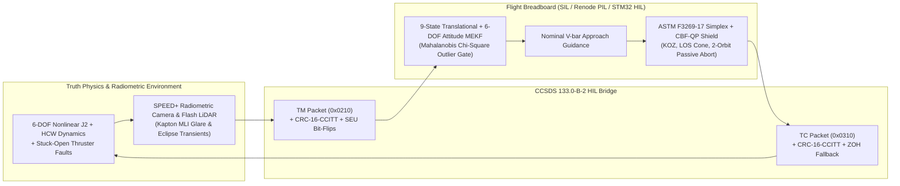

<div align="center">

# 🛰️ CERTI-RPO-HIL
### Certifiable Autonomous Rendezvous, Proximity Operations & Docking (RPOD) Radiometric Optical Navigation & Control Barrier Function (CBF) Runtime Assurance HIL Testbed

[](https://python.org)
[](LICENSE)
[]()
[]()

<p align="center">
  <b>Bridging the TRL 3 → TRL 4 Valley of Death for Autonomous On-Orbit Servicing &amp; Debris Removal</b><br>
  <i>Coupling Nonlinear $J_2$ 6-DOF Relative Dynamics, Stanford SLAB SPEED+ Radiometric Glare/Eclipse Sensing, ASTM F3269-17 CBF-QP Safety Shields, and Binary CCSDS 133.0-B-2 HIL Framing.</i>
</p>

</div>

---

## 🌍 Institutional Acknowledgement & Attribution

This engineering testbed is developed under the technical sponsorship of:
* **DIMASA (Digital Intelligence Maintenance for Aircraft Systems in Africa)**
* **Physics Hybrid Integrity Lab**

---

## 🧭 Architecture & Air-Gapped HIL Design



---

## 🏛️ Seven-Pillar TRL 4 Verification Matrix

| Pillar | Standard | What It Verifies |
| :--- | :--- | :--- |
| **1. KOZ & LOS Barrier Invariance** | `ASTM F3269-17` | Zero excursions into Target Keep-Out Sphere ($R_{\text{KOZ}} = 2.0\text{ m}$) or outside the $20^\circ$ V-bar LOS cone. |
| **2. Passive Abort 2-Orbit Free-Drift** | `ECSS-E-ST-10-02C` | Guarantees a collision-free 2-orbit unpowered HCW drift trajectory if all thrusters cut off at any instant prior to final capture gate. |
| **3. Radiometric Glare & Eclipse MEKF** | `SLAB SPEED+ HIL` | Rejects specular Kapton MLI BRDF glare spikes and eclipse penumbra transients via $\chi^2_{3,0.999}$ Mahalanobis innovation gating. |
| **4. Thruster Fault Tolerance** | `NASA GPR 8705.2` | Estimates and cancels a $+0.032\text{ m/s}^2$ stuck-open thruster bias + $28\%$ actuator degradation during final approach. |
| **5. CCSDS 133.0-B-2 HIL Bus Integrity** | `CCSDS 133.0-B-2` | Binary space packet framing with 100% CRC-16-CCITT single-bit SEU detection and zero-order-hold (ZOH) recovery. |
| **6. Cryptographic Reproducibility** | `NASA-STD-7009A` | Bitwise deterministic trajectory reproduction verified via SHA-256 state digests. |
| **7. Real-Time 50 Hz Frame Budget** | `DO-178C DAL B` | Sub-millisecond CBF-QP execution ($P_{99} < 2,000\,\mu\text{s}$ within a $20,000\,\mu\text{s}$ 50 Hz frame). |

---

## ⚡ Quickstart

```bash
# Run the automated 16-test pytest verification suite
C:\Users\User\anaconda3\anacondaa\envs\aerospace\python.exe -m pytest tests/ -v

# Execute the full TRL 4 benchmark campaign and generate reports/
C:\Users\User\anaconda3\anacondaa\envs\aerospace\python.exe examples/run_rpo_trl4_campaign.py
```

Generated artifacts in `reports/`:
* [`reports/rpo_trl4_scorecard.html`](reports/rpo_trl4_scorecard.html) — Interactive HTML5 Control Room Dashboard
* [`reports/TRL4_DOSSIER.md`](reports/TRL4_DOSSIER.md) — Markdown Certification Dossier
* [`reports/trl4_audit.json`](reports/trl4_audit.json) — Machine-Readable Audit Manifest
